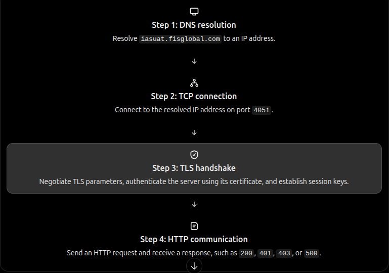
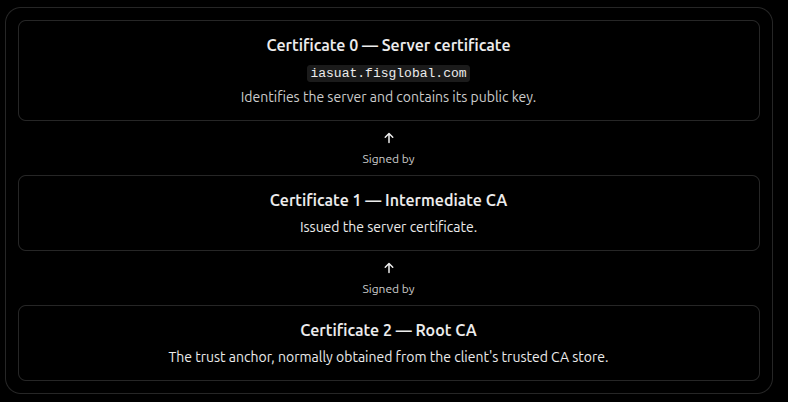
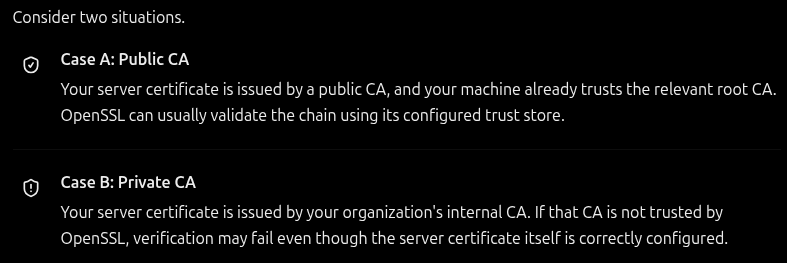

# HTTPs Communication



1. **TCP** :- Establish a network connection.
2. **TLS** :- Protects the communication and authenticates the server.
3. **Certificate Verification** :- Checks whether the server's identity can be trusted or not.
4. **HTTP** carries the actual API request and response.

---

## 1. `curl -v https://...`

### Your Command :-
```bash
curl -v https://iasuat.fisglobal.com:4051/
```

### What is curl ?

curl is a commandline tool for communicating with servers using a protocols such as HTTP and HTTPS.

When you execute the above command, curl attempts to :- 
1. Resolve the hostname.
2. Establish a TCP connection to port 4051.
3. Perform a TLS handshake.
4. Verify the server's certificate and hostname.
5. Send an HTTP GET request for /.
6. Display the HTTP response.

The **-v** option means **Verbose**. It prints detailed diagnostics information about the connection.

### Understand the output :- 

```shell
*   Trying 10.4.90.250:4051...
* Connected to iasuat.fisglobal.com (10.4.90.250) port 4051
* TLSv1.2 (OUT), TLS handshake, Client hello (1):
* TLSv1.2 (IN), TLS handshake, Server hello (2):
* SSL connection using TLSv1.2
* Server certificate:
*  subject: CN=iasuat.fisglobal.com
*  issuer: ...
* SSL certificate verify ok.
> GET / HTTP/1.1
> Host: iasuat.fisglobal.com:4051
>
< HTTP/1.1 200 OK
< Content-Type: application/json
```

| Parameter                      | Description                                                                           |
|--------------------------------|---------------------------------------------------------------------------------------|
| `Trying ...`                   | Curl is attempting to connect to an IP address.                                       |
| `Connected to ...`             | The TCP connection was established.                                                   |
| `Client hello`                 | Your client begins TLS negotiation.                                                   |
| `Server hello`                 | The server responds with its selected TLS parameters.                                 |
| `SSL connection using TLSv1.2` | TLS negotiation succeeded using that version.                                         |
| `SSL certificate verify ok`    | Certificate verification succeeded under curl's configured trust and hostname checks. |
| `> GET / HTTP/1.1`             | Curl is sending an HTTP request.                                                      |
| `< HTTP/1.1 200 OK`            | The server returned a successful HTTP response.                                       |

1. `>` lines represent outgoing HTTP request data
2. `<` lines represent incoming HTTP response

### Common Errors :- 


```shell
curl: (60) SSL certificate problem:
unable to get local issuer certificate
```

1. This usually means curl could not build a trusted certificate chain from the server's certificate to a trusted CA certificate.
2. The server might still be reachable, and TCP might be working perfectly. The problem is certificate verification.

```shell
curl: (7) Failed to connect
```

1. This indicates a connection failure, which may involve the port, network route, firewall, or service availability.
2. It does not necessarily indicate a TLS or certificate problem.


---

## 2. `openssl s_client -showcerts`

### Your command :-

```shell
openssl s_client \
  -connect iasuat.fisglobal.com:4051 \
  -servername iasuat.fisglobal.com \
  -showcerts
```

* If Port not defined use default port for HTTPs :- `443` 
1. Default Port of HTTPs :-  `443`
2. Default Port of HTTP :-  `80`

```shell
openssl s_client \
  -connect iasuat.fisglobal.com:443 \
  -servername iasuat.fisglobal.com \
  -showcerts
```

* You can use IP Address instead of DNS name also ?

```shell
openssl s_client \
  -connect 10.121.78.187:443 \
  -servername iasuat.fisglobal.com \
  -showcerts
```

### What is `s_client` ?

1. OpenSSL's `s_client` is a diagnostic TLS client.
2. It allows you to connect to a TLS-enabled server and inspect what happens during the handshake.
3. Unlike curl, its primary purpose is to help you examine the TLS connection rather than make a convenient HTTP API request.

| Parameter                   | Description                                          |
|-----------------------------|------------------------------------------------------|
| `openssl`                   | Runs the OpenSSL toolkit.                            |
| `s_client`                  | Starts a TLS client connection.                      |
| `-connect hostname:port`    | Specifies the TCP destination.                       |
| `-servername hostname`      | Sends the hostname in the TLS ClientHello using SNI. |
| `-showcerts`                | Displays the certificate list sent by the server.    |

### What is SNI, and why does it matter ?

Suppose one server IP hosts two HTTPs services :- 
1. `iasuat.fisglobal.com`
2. `another-service.example.com`

* Both hostnames may resolve to the same IP address and use the same port, but they may need different certificates.
* During the TLS handshake, the client can send the desired hostname using **Server Name Indication (SNI)**.
* The Server can use this hostname to choose the appropriate certificate.
* That is why this option is useful :-
```text
-servername iasuat.fisglobal.com
```
* Without it, the server might return a default certificate instead of the certificate intended for your hostname.

### Understanding the certificate chain



### Example of `-showcerts` output :- 

```shell
Certificate chain
 0 s:CN = iasuat.fisglobal.com
   i:CN = Example Intermediate CA

 1 s:CN = Example Intermediate CA
   i:CN = Example Root CA

---
Server certificate
-----BEGIN CERTIFICATE-----
MIID...
-----END CERTIFICATE-----
```

#### The abbreviations mean :-
* `s` = **subject** : The identity described by the certificate
* `i` = **issuer** : The CA that issued or signed the certificate
* `0` = the first certificate in the server-provided list, normally the leaf certificate.
* `1` = The next certificate, often an intermediate CA certificate.


---

## 3. `openssl s_client -verify_return_error`

### Your command :-

```shell
openssl s_client \
  -connect iasuat.fisglobal.com:4051 \
  -servername iasuat.fisglobal.com \
  -verify_return_error
```

1. The purpose of `-verify_return_error` is to make certificate-verification errors fatal rather than simply reporting them and continuing.
2. However, **you should explicitly enable certificate verification and hostname verification when you want to test whether the server certificate is trusted for a specific hostname**. A robust command is:

```bash
openssl s_client \
  -connect iasuat.fisglobal.com:4051 \
  -servername iasuat.fisglobal.com \
  -showcerts \
  -verify 5 \
  -verify_hostname iasuat.fisglobal.com \
  -verify_return_error
```

| Option                                  | Purpose                                                                              |
|-----------------------------------------|--------------------------------------------------------------------------------------|
| `-verify 5`                             | Enables peer certificate verification, with a maximum verification-chain depth of 5. |
| `-verify_hostname iasuat.fisglobal.com` | Checks whether the certificate identifies the intended hostname.                     |
| `-verify_return_error`                  | Stops the connection when certificate verification fails.                            |

The depth of `5` is an example, not a requirement for every certificate chain.

### What exactly is certificate verification ?
When your client receives the server certificate, it must decide whether to trust it.

The client typically checks :-  
1. **Certificate Validity Period** :- Is the certificate within it's `Not Before` and `Not After` dates ?
2. **Certificate Chain** :- Can the certificate be linked through valid intermediate certificates to a trusted CA ?
3. **Certificate Signature** :-  Are the certificate signature valid ?
4. **Hostname** :-  Does the certificate cover `iasuat.fisglobal.com` ? 
5. **Usage and Constraints** :- Are the certificates appropriate for server authentication and consistent with CA constraints ?

### Example - Successful Verification

```text
Verification: OK
Verify return code: 0 (ok)
```
This indicates that the configured verification checks succeeded.

### Example - Unsuccessful Verification

```text
verify error:num=20:unable to get local issuer certificate
```
This means OpenSSL could not find the issuer certificate needed to build a trusted chain.
Possible reason include :-
* The server omitted a required intermediate certificate.
* The relevant CA certificate is missing from the client's trust store.
* The client is using the wrong CA bundle.
* The server uses an internal CA that the client does not trust.

**Remember** :-
1. A server can present a valid-looking certificate and complete the TLS handshake even when your client cannot establish trust in that certificate. 
2. Using `-verify_return_error` helps make such failures explicit when verification is enabled.


---

## What is `-CAfile`, and why do we need it ?

This is particularly important when you work with banking systems, UAT environments, internal APIs, or private certificate authorities.



### What does `-CAfile` do ?
The `-CAfile` option tells OpenSSL which file contains trusted CA certificates to use during certificate verification.

```shell
openssl s_client \
  -connect iasuat.fisglobal.com:4051 \
  -servername iasuat.fisglobal.com \
  -verify 5 \
  -verify_hostname iasuat.fisglobal.com \
  -verify_return_error \
  -CAfile /etc/ssl/certs/company-ca.pem
```

Here, 
1. `company-ca.pem` contains a CA certificate trusted by your organization.
2. OpenSSL uses it as part of the trust configuration.
3. OpenSSL tries to build and verify the server's certificate chain against that trust.

* The file should contain the appropriate trusted CA certificate or certificates. 
* If the CA hierarchy requires an intermediate certificate, OpenSSL may also need that certificate to build the chain, depending on what the server provides and what is available locally.

---

## 4. Test the HTTPs API using curl

```shell
curl -v \
  --cacert /etc/ssl/certs/company-ca.pem \
  https://iasuat.fisglobal.com:4051/
```

1. The `--cacert` option supplies a CA certificate bundle for curl to use during verification.
2. If the server uses a public CA that is already trusted by your system, you may not need this option.


---

## 5. Inspect the TLS connection using OpenSSL

```shell
openssl s_client \
  -connect iasuat.fisglobal.com:4051 \
  -servername iasuat.fisglobal.com \
  -showcerts \
  -verify 5 \
  -verify_hostname iasuat.fisglobal.com \
  -verify_return_error \
  -CAfile /etc/ssl/certs/company-ca.pem
```

---

### Note :- 

If your goal is to troubleshoot a Spring Boot API call, I recommend using both: 
1. **curl** to test the HTTPS request and 
2. **OpenSSL** to investigate the certificate chain and TLS handshake.

---