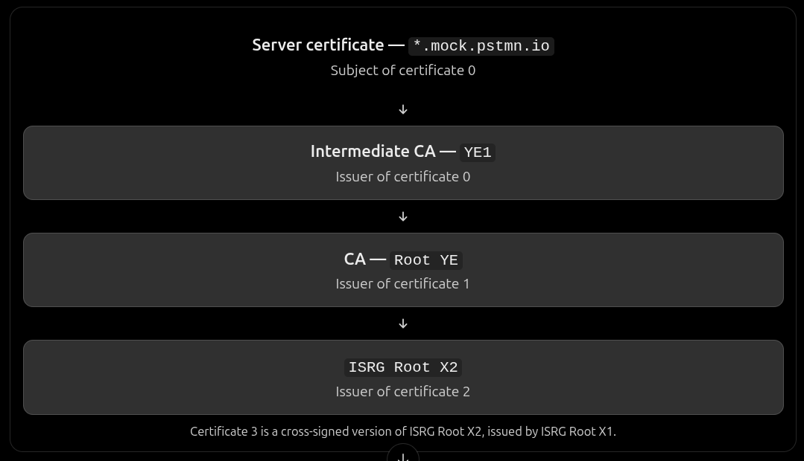
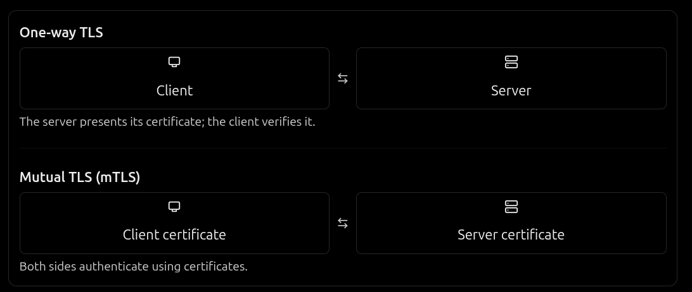

# Certificate Chain

### Request :- 

```shell
openssl s_client \
  -connect 9c3deb1b-bfc2-4486-a165-4e9254ce6771.mock.pstmn.io:443 \
  -showcerts
```

### Output :-

```shell
CONNECTED(00000003)
depth=3 C = US, O = Internet Security Research Group, CN = ISRG Root X2
verify return:1
depth=2 C = US, O = ISRG, CN = Root YE
verify return:1
depth=1 C = US, O = Let's Encrypt, CN = YE1
verify return:1
depth=0 CN = *.mock.pstmn.io
verify return:1
---
Certificate chain
 0 s:CN = *.mock.pstmn.io
   i:C = US, O = Let's Encrypt, CN = YE1
   a:PKEY: id-ecPublicKey, 256 (bit); sigalg: ecdsa-with-SHA384
   v:NotBefore: Sep 24 14:34:51 2026 GMT; NotAfter: Dec 23 14:34:50 2026 GMT
-----BEGIN CERTIFICATE-----
MIIDozCCAymgAwIBAgISBmAS+8AAXGitC4jJzrl9t2O0MAoGCCqGSM49BAMDMDMx
CzAJBgNVBAYTAlVTMRYwFAYDVQQKEw1MZXQncyBFbmNyeXB0MQwwCgYDVQQDEwNZ
RTEwHhcNMjYwOTI0MTQzNDUxWhcNMjYxMjIzMTQzNDUwWjAaMRgwFgYDVQQDDA8q
Lm1vY2sucHN0bW4uaW8wWTATBgcqhkjOPQIBBggqhkjOPQMBBwNCAAR2M+oNVRrC
ADgDTWdll7f0wWty1cS0ISQSCKOgCZl+uTUxGCumgaZ7LWJIxUJM6QFPnNhM0v+L
RVsYU+dkLbFEo4ICNDCCAjAwDgYDVR0PAQH/BAQDAgeAMBMGA1UdJQQMMAoGCCsG
AQUFBwMBMAwGA1UdEwEB/wQCMAAwHQYDVR0OBBYEFIwEqkLrnvcDRxrztav4JiCA
X+h2MB8GA1UdIwQYMBaAFLsgykcL/tflnPmPCSqjjDdFsbzYMDMGCCsGAQUFBwEB
BCcwJTAjBggrBgEFBQcwAoYXaHR0cDovL3llMS5pLmxlbmNyLm9yZy8wMAYDVR0R
BCkwJ4IPKi5tb2NrLnBzdG1uLmlvggoqLnBzdG1uLmlvgghwc3Rtbi5pbzATBgNV
HSAEDDAKMAgGBmeBDAECATAuBgNVHR8EJzAlMCOgIaAfhh1odHRwOi8veWUxLmMu
bGVuY3Iub3JnLzUzLmNybDCCAQ0GCisGAQQB1nkCBAIEgf4EgfsA+QB3AJROQ4f6
7MHvgfMZJCaoGGUBx9NfOAIBP3JnfVU3LhnYAAABoNQMxGIAAAQDAEgwRgIhAMno
bDryhdjELEVTy/lyt4Fgkz0vmGrEr0zlXEI9P84xAiEA9AnqJ3yGG2aaskyGp1GE
h2Wna8cM5rSnDr4mxAFnqvUAfgBGr4Y9Oz7ln6V33qgkXTaw2e0ioiP0YXdBIpRS
7pVQXwAAAaDUDMTHAAgAAAUANPszVAQDAEcwRQIhAJNcNz4i46FxiKwXxl9IyLAE
S2A7XhD/5mEhy+8AsGe6AiARhqPUylwM9ELM7ZOLvzLDtgviYfDBVpTrSKsg9iMZ
9DAKBggqhkjOPQQDAwNoADBlAjBcDKTYEZGmNWPOiFLTe9WLPtPSQ+rqL2k1tuOE
OA/+olbmVo/mWDDSrwuYPWyp4zwCMQC1aow4sbnfRo/Glxf1Mw36jrpnwi92i3GO
8YUcDZnEgfuAd576jAgUEgCelm30uGg=
-----END CERTIFICATE-----
 1 s:C = US, O = Let's Encrypt, CN = YE1
   i:C = US, O = ISRG, CN = Root YE
   a:PKEY: id-ecPublicKey, 384 (bit); sigalg: ecdsa-with-SHA384
   v:NotBefore: Sep  3 00:00:00 2025 GMT; NotAfter: Sep  2 23:59:59 2028 GMT
-----BEGIN CERTIFICATE-----
MIICizCCAhGgAwIBAgIQXd1w3TH4AchcGGp6BLgK/jAKBggqhkjOPQQDAzAuMQsw
CQYDVQQGEwJVUzENMAsGA1UEChMESVNSRzEQMA4GA1UEAxMHUm9vdCBZRTAeFw0y
NTA5MDMwMDAwMDBaFw0yODA5MDIyMzU5NTlaMDMxCzAJBgNVBAYTAlVTMRYwFAYD
VQQKEw1MZXQncyBFbmNyeXB0MQwwCgYDVQQDEwNZRTEwdjAQBgcqhkjOPQIBBgUr
gQQAIgNiAAQHZVB1/mimla2hfSurylScjPMZaOJXLz/NnAc2sylm8WDyhU9Ccp+z
ASQi5vSwGGJjSGklkD9fdPR8GpyDIOIjCEfrnbt/v+ZSEPLLEGbaM6EccDbN7p9x
teIm2Avf+ryjge4wgeswDgYDVR0PAQH/BAQDAgGGMBMGA1UdJQQMMAoGCCsGAQUF
BwMBMBIGA1UdEwEB/wQIMAYBAf8CAQAwHQYDVR0OBBYEFLsgykcL/tflnPmPCSqj
jDdFsbzYMB8GA1UdIwQYMBaAFKPIJlqOoUzQNWP8myPIOq5W809WMDIGCCsGAQUF
BwEBBCYwJDAiBggrBgEFBQcwAoYWaHR0cDovL3llLmkubGVuY3Iub3JnLzATBgNV
HSAEDDAKMAgGBmeBDAECATAnBgNVHR8EIDAeMBygGqAYhhZodHRwOi8veWUuYy5s
ZW5jci5vcmcvMAoGCCqGSM49BAMDA2gAMGUCMQDgjUEahFT/h3DRakqiPZpLvPgf
Zwkt6K2EOMmh1nvEzl83eMLYcod4GCl3b0J1Nn0CMBNYmEQJb4CEG5WoOe7aRn/L
VKu6saHmHEynI7ysIPd8zQsK1HdmhlHKlw9Z5GpGvA==
-----END CERTIFICATE-----
 2 s:C = US, O = ISRG, CN = Root YE
   i:C = US, O = Internet Security Research Group, CN = ISRG Root X2
   a:PKEY: id-ecPublicKey, 384 (bit); sigalg: ecdsa-with-SHA384
   v:NotBefore: May 13 00:00:00 2026 GMT; NotAfter: Sep  2 23:59:59 2032 GMT
-----BEGIN CERTIFICATE-----
MIICpjCCAiugAwIBAgIRAIchZfw0tuX7qK3Vs3BftTowCgYIKoZIzj0EAwMwTzEL
MAkGA1UEBhMCVVMxKTAnBgNVBAoTIEludGVybmV0IFNlY3VyaXR5IFJlc2VhcmNo
IEdyb3VwMRUwEwYDVQQDEwxJU1JHIFJvb3QgWDIwHhcNMjYwNTEzMDAwMDAwWhcN
MzIwOTAyMjM1OTU5WjAuMQswCQYDVQQGEwJVUzENMAsGA1UEChMESVNSRzEQMA4G
A1UEAxMHUm9vdCBZRTB2MBAGByqGSM49AgEGBSuBBAAiA2IABDwS/6vhrcVqcbBo
+wgdI3fwn9x7DNJJOY/lTOti0vkwuRN87RhEhTH17E7XyFjWsPYhIPt/wzOqxTd2
b+4ZJNy9ID04YywF9U5zasDVyGSNErVNtz8uSGh5izW87j77GaOB6zCB6DAOBgNV
HQ8BAf8EBAMCAQYwEwYDVR0lBAwwCgYIKwYBBQUHAwEwDwYDVR0TAQH/BAUwAwEB
/zAdBgNVHQ4EFgQUo8gmWo6hTNA1Y/ybI8g6rlbzT1YwHwYDVR0jBBgwFoAUfEKW
rt5LSDv6kviejM9ti6lyN5UwMgYIKwYBBQUHAQEEJjAkMCIGCCsGAQUFBzAChhZo
dHRwOi8veDIuaS5sZW5jci5vcmcvMBMGA1UdIAQMMAowCAYGZ4EMAQIBMCcGA1Ud
HwQgMB4wHKAaoBiGFmh0dHA6Ly94Mi5jLmxlbmNyLm9yZy8wCgYIKoZIzj0EAwMD
aQAwZgIxAMU19WCtmxVND8UHBZRoma49Z7jPs64Dma0eTu1OChVbB/2J7GV3nvYK
Ax54uk1G9QIxAO0miLVJu8PLNiXXXkiE/gsK3CTRTF/aeo4bMX42Zw40csRU6AC2
6hSW1/IWaas6dg==
-----END CERTIFICATE-----
 3 s:C = US, O = Internet Security Research Group, CN = ISRG Root X2
   i:C = US, O = Internet Security Research Group, CN = ISRG Root X1
   a:PKEY: id-ecPublicKey, 384 (bit); sigalg: RSA-SHA256
   v:NotBefore: May 13 00:00:00 2026 GMT; NotAfter: Sep  2 23:59:59 2032 GMT
-----BEGIN CERTIFICATE-----
MIIEcDCCAligAwIBAgIQbI8dxyfHEX97r4U6yYD5zTANBgkqhkiG9w0BAQsFADBP
MQswCQYDVQQGEwJVUzEpMCcGA1UEChMgSW50ZXJuZXQgU2VjdXJpdHkgUmVzZWFy
Y2ggR3JvdXAxFTATBgNVBAMTDElTUkcgUm9vdCBYMTAeFw0yNjA1MTMwMDAwMDBa
Fw0zMjA5MDIyMzU5NTlaME8xCzAJBgNVBAYTAlVTMSkwJwYDVQQKEyBJbnRlcm5l
dCBTZWN1cml0eSBSZXNlYXJjaCBHcm91cDEVMBMGA1UEAxMMSVNSRyBSb290IFgy
MHYwEAYHKoZIzj0CAQYFK4EEACIDYgAEzZvVn4CDCuwJSvMWSj5cz3es3mcFDR0H
ttwW+1qLFNvicWDEukWVEYmO6gbf9yoWHKS5xcUy4APgHoIYOIvXRdgKam7mAHf7
AlF9ItgKbppbd9/w+kHsOdx1ymgHDB/qo4H1MIHyMA4GA1UdDwEB/wQEAwIBBjAd
BgNVHSUEFjAUBggrBgEFBQcDAQYIKwYBBQUHAwIwDwYDVR0TAQH/BAUwAwEB/zAd
BgNVHQ4EFgQUfEKWrt5LSDv6kviejM9ti6lyN5UwHwYDVR0jBBgwFoAUebRZ5nu2
5eQBc4AIiMgaWPbpm24wMgYIKwYBBQUHAQEEJjAkMCIGCCsGAQUFBzAChhZodHRw
Oi8veDEuaS5sZW5jci5vcmcvMBMGA1UdIAQMMAowCAYGZ4EMAQIBMCcGA1UdHwQg
MB4wHKAaoBiGFmh0dHA6Ly94MS5jLmxlbmNyLm9yZy8wDQYJKoZIhvcNAQELBQAD
ggIBAD2/e9frmMxNpCV03qUHegg+MV2wz9644YoXdqtH8RyWYcBO7xfjjGEXdU1e
/o0OkEFiynUCOSIk/vLLo7ttz6CPAeNlWfC0XNkoGeWgK6jjXvozBaGuGH5n0Ufo
shMeWTuURqNN5G00sSXDTBrpp2+mgvdZQjb8K11TYMA25QA+YHNfbIEL0BniAhKS
2gsnJjSzrdZLI+EZ7SEyqdR2rkjd1KutLDU+n3TFyxjniZVGur4YlhMP3mY/dV95
IruAkkjOZier6hGBdEgZXXvaCz9u9iVEadsIE75pAGL8oHV5vxdARDiotRpul1IN
/UZwzAbrfUFcw1HkAcYD/mlZfnQ2ieCF2MS7j3Vhv7JPDKp45fmykmzYNSrumRW0
upFFKDBOoF7hsOb7oLyHS+Uft6jOUfOrogj8YUx38hKb2K20r42OgsSdDdxdeYWc
MS3Sb6mwJeSZEYxJ2gaXnDSPaKhhrNkYwljyVQyr4Nq+MEJytXNTnHqaAcrNwZlV
pcJL1KBnMrMjP7eanvUwL3FYj3cF17jtboLt7gLoi4+2rWZFvn+w54jmd/FIuhhZ
cEaU/wvU6BUNMtcVquVGHp7itQeDth5j+XL3j4WJ2SABwzUl6OeYdgpIt/ITZa+p
TT0mQ/r5XyA4MEAiabn7XJjvCERlF2dcn2wqJw+CreTkkQ2R
-----END CERTIFICATE-----
---
Server certificate
subject=CN = *.mock.pstmn.io
issuer=C = US, O = Let's Encrypt, CN = YE1
---
No client certificate CA names sent
Peer signing digest: SHA256
Peer signature type: ECDSA
Server Temp Key: X25519, 253 bits
---
SSL handshake has read 3735 bytes and written 432 bytes
Verification: OK
---
New, TLSv1.3, Cipher is TLS_AES_256_GCM_SHA384
Server public key is 256 bit
Secure Renegotiation IS NOT supported
Compression: NONE
Expansion: NONE
No ALPN negotiated
Early data was not sent
Verify return code: 0 (ok)
---
---
Post-Handshake New Session Ticket arrived:
SSL-Session:
    Protocol  : TLSv1.3
    Cipher    : TLS_AES_256_GCM_SHA384
    Session-ID: 11FBCA37398AEF83C29873453AA55EA1C2B96E83FAB7DD748D212DCB8F6FA252
    Session-ID-ctx: 
    Resumption PSK: 0AB4B1212EB7787AEE823C6CBE41F6A4BFBE5E1B4C72154A7912EB1E7E604610105C23CEFEB6E8A36C4071C926999D3F
    PSK identity: None
    PSK identity hint: None
    SRP username: None
    TLS session ticket lifetime hint: 64800 (seconds)
    TLS session ticket:
    0000 - bb a2 8e 85 7f df a7 ea-3b f7 78 5d 9c 69 60 1f   ........;.x].i`.
    0010 - f5 01 e2 77 e9 36 51 32-75 41 01 6f ca b4 f6 e1   ...w.6Q2uA.o....
    0020 - ab 0f 7a df d1 3a 7d 04-43 cc 31 c7 26 42 f8 6b   ..z..:}.C.1.&B.k
    0030 - 3f 64 31 d0 38 38 95 99-48 b6 e7 9a 35 29 27 ed   ?d1.88..H...5)'.
    0040 - 40 0d 3d 72 7c 06 28 78-9c e8 20 36 44 ef 4e a8   @.=r|.(x.. 6D.N.
    0050 - 50 ec 0b e0 7e 04 db ce-ae 7c 0d a5 b3 ec 90 f1   P...~....|......
    0060 - 6d 20 d8 29 75 50 dc 1c-b6 d4 9b 9e d3 94 5f 2a   m .)uP........_*
    0070 - 4b c7 ec 37 fa 20 62 a8-0a 3f 30 85 d3 11 a7 8b   K..7. b..?0.....
    0080 - 26 73 f8 0d ac 1c 0f e7-89 aa aa e9 7c 45 67 49   &s..........|EgI
    0090 - bc 11 d0 c0 e0 47 c4 d5-2a 92 4c e6 0d cb 1d 97   .....G..*.L.....
    00a0 - 54 96 ce 60 72 9d c5 02-bd 38 4f 32 7b 64 91 c5   T..`r....8O2{d..
    00b0 - 2f ad 3f 93 9b 97 2e da-68 fb a7 b0 ee 04 1f 3d   /.?.....h......=

    Start Time: 1792935668
    Timeout   : 7200 (sec)
    Verify return code: 0 (ok)
    Extended master secret: no
    Max Early Data: 0
---
read R BLOCK
---
Post-Handshake New Session Ticket arrived:
SSL-Session:
    Protocol  : TLSv1.3
    Cipher    : TLS_AES_256_GCM_SHA384
    Session-ID: D83C31663F27FD2AABFB5C034F96AABF857A1713068DED1BD5F59B8E88CEC337
    Session-ID-ctx: 
    Resumption PSK: 28FFE383F30EDE8FD11C0E4A4137098D108D9F0F6098DB66674F2E4FB2F3DA7EAA20A1045E731AF5C8A3C9AAE7B54784
    PSK identity: None
    PSK identity hint: None
    SRP username: None
    TLS session ticket lifetime hint: 64800 (seconds)
    TLS session ticket:
    0000 - bb a2 8e 85 7f df a7 ea-3b f7 78 5d 9c 69 60 1f   ........;.x].i`.
    0010 - bc 12 76 10 a4 26 5f 54-cf ef 86 b8 51 6f d4 7d   ..v..&_T....Qo.}
    0020 - be 75 be 0e 19 de c1 3a-c6 5e c0 87 76 de 47 30   .u.....:.^..v.G0
    0030 - 48 79 27 11 c5 9a 46 d7-83 8b 56 f8 51 fa 80 96   Hy'...F...V.Q...
    0040 - 1d e8 28 83 33 38 0d c2-ab c4 32 ef 8e 0b ba e7   ..(.38....2.....
    0050 - 76 76 a0 4c b9 b9 b8 2d-3b 15 24 36 81 e7 d7 e3   vv.L...-;.$6....
    0060 - 28 27 5e 4b b5 36 2b 4f-e3 92 87 25 89 19 53 51   ('^K.6+O...%..SQ
    0070 - e4 86 c7 5d 0b 5e ce 37-e7 78 d0 94 5d fa 9a 1c   ...].^.7.x..]...
    0080 - 74 b1 fb 06 a9 92 49 1d-3d 8b ef e1 32 eb 44 1d   t.....I.=...2.D.
    0090 - c2 6e bf eb 65 a4 11 0c-33 73 55 0f ab e0 36 50   .n..e...3sU...6P
    00a0 - d1 78 9f d6 67 fd 15 0d-4f 9a 8f e8 b9 4f 1f 84   .x..g...O....O..
    00b0 - 3c 34 c8 08 67 4e 63 16-d6 a4 99 99 ce 8b 70 51   <4..gNc.......pQ

    Start Time: 1792935668
    Timeout   : 7200 (sec)
    Verify return code: 0 (ok)
    Extended master secret: no
    Max Early Data: 0
---
read R BLOCK
closed
```

---

## 1. Connection Establishment :-

```text
CONNECTED(00000003)
```

| Output           | Meaning                                                                                                              |
|------------------|----------------------------------------------------------------------------------------------------------------------|
| `CONNECTED`      | The TCP connection to the server was established.                                                                    |
| `00000003`       | An internal file descriptor used by OpenSSL to represent the connection. It is not a port number or certificate ID.  |

Your Client connects to port `443`, the standard HTTPS port.

The connection happens in two main stages:
1. `TCP connection` : Establishes the network connection to the server.
2. `TLS handshake` : Negotiates security parameters, authenticates the server and establishes cryptographic keys.

A successful TCP connection alone does not mean TLS verification will succeed. In your output, both stages succeeded.

---

## 2. Understanding `depth` and `verify return` :-

```text
depth=3 C = US, O = Internet Security Research Group, CN = ISRG Root X2
verify return:1

depth=2 C = US, O = ISRG, CN = Root YE
verify return:1

depth=1 C = US, O = Let's Encrypt, CN = YE1
verify return:1

depth=0 CN = *.mock.pstmn.io
verify return:1
```

### What does `depth` mean ?

#### `depth` indicates a certificate's position in the chain being verified, with the leaf/server certificate at depth `0`.

| Depth | Certificate       | Role                                                 |
|-------|-------------------|------------------------------------------------------|
| 0     | `*.mock.pstmn.io` | Server's leaf certificate.                           |
| 1     | `YE1`             | Intermediate CA that issued the server certificate.  |
| 2     | `Root YE`         | CA certificate that issued `YE1`.                    |
| 3     | `ISRG Root X2`    | Higher-level CA certificate in the presented chain.  |

The `C`, `O`, and `CN` fields mean :-
* `C` : Country
* `O` : Organization
* `CN` : Common Name

### What does `verify return:1` mean ?

* It means the verification callback accepted that certificate at that stage. It does not, by itself, mean that the entire connection has completed successfully.
* That indicates successful certificate-chain verification.

---

## 3. The `Certificate chain` Section :-

```text
Certificate chain
 0 s:CN = *.mock.pstmn.io
   i:C = US, O = Let's Encrypt, CN = YE1
   a:PKEY: id-ecPublicKey, 256 (bit); sigalg: ecdsa-with-SHA384
   v:NotBefore: Sep 24 14:34:51 2026 GMT
   v:NotAfter: Dec 23 14:34:50 2026 GMT
```

### 3.1 Certificate Number `0` :-

```text
0 s:CN = *.mock.pstmn.io
```

* `0` is the first certificate in the server-provided list.
* `s` stands for **subject**.
* `CN = *.mock.pstm.io` is the certificate Common Name

Modern TLS hostname verification primarily uses the certificate's Subject Alternative Name (SAN) extension. Your certificate's encoded SAN includes `*.mock.pstmn.io`, `*.pstmn.io`, and `pstmn.io`.


### 3.2 Who issued the certificate ?

```text
i:C = US, O = Let's Encrypt, CN = YE1
```

Here, `i` means **issuer**.
The server certificate was issued by the Let's Encrypt CA named `YE1`.
The relationship is :-



The final certificate in the chain sent by this server is not necessarily the root certificate your client ultimately trusts. A trust anchor normally comes from the client's local trust store.

---

## 4. Why are there four certificates ?

#### Your output contains certificate indexes `0`, `1`, `2`, and `3`.

| Depth | Subject             | Issuer               |
|-------|---------------------|----------------------|
| 0     | `*.mock.pstmn.io`   | Let's Encrypt `YE1`. |
| 1     | Let's Encrypt `YE1` | `Root YE`.           |
| 2     | `Root YE`           | `ISRG Root X2`.      |
| 3     | `ISRG Root X2`      | `ISRG Root X1`.      |


* The last certificate is cross-signed: its subject is `ISRG Root X2`, but its issuer is `ISRG Root X1`.
* Cross-signing allows a CA certificate to be authenticated through another CA's certificate, potentially supporting different trust paths.

#### **Important** :-

* The server sending four certificates does not mean your client must import all four into its trust store. 
* Usually, the client trusts an appropriate root CA already present in its trust store and receives the necessary intermediate certificates from the server. 
* The exact trust path depends on the client's trust configuration.


---

## 5. Server Certificate Summary :-

```text
Server certificate
subject=CN = *.mock.pstmn.io
issuer=C = US, O = Let's Encrypt, CN = YE1
```

This is a convenient summary of the leaf certificate.

| Field     | Meaning                                                     |
|-----------|-------------------------------------------------------------|
| `subject` | The identity the certificate represents: `*.mock.pstmn.io`. |
| `issuer`  | The CA that issued the certificate: `Let's Encrypt YE1.`.   |


---

## 6. Does the server require a client certificate ?

```text
No client certificate CA names sent
```

* This means the server did not send a list of acceptable client certificate authorities in the handshake message represented by this output.
* It is consistent with an ordinary HTTPS connection where the server authenticates itself, but the client does not authenticate using a certificate.

#### There are two common TLS authentication scenarios :-



* Your output does not indicate that the server requested a client certificate during this handshake. Therefore, you do not appear to need a client keystore for this connection. 
* You would generally need a truststore or default CA trust configuration to validate the server, depending on your Java environment.

---